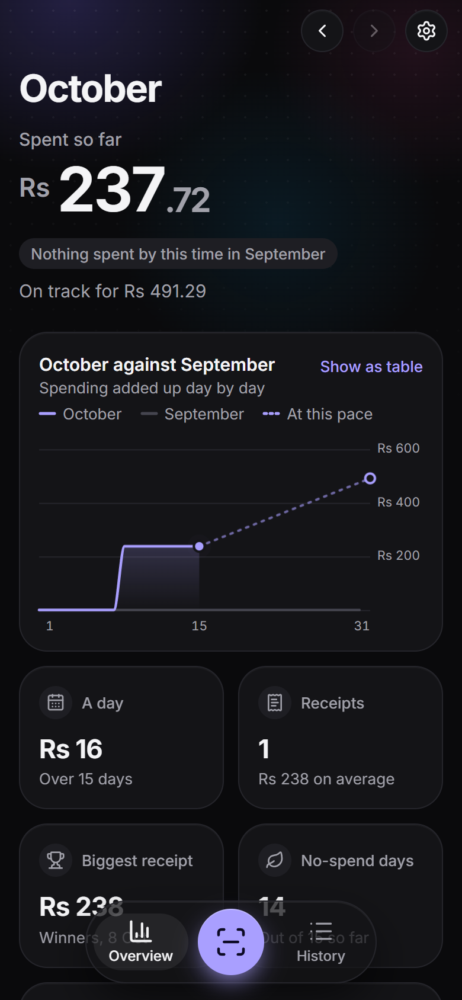
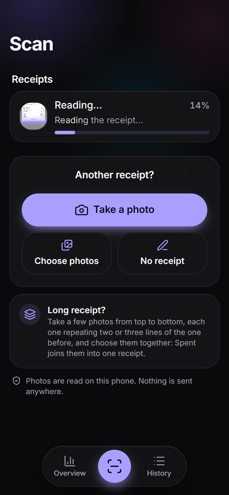
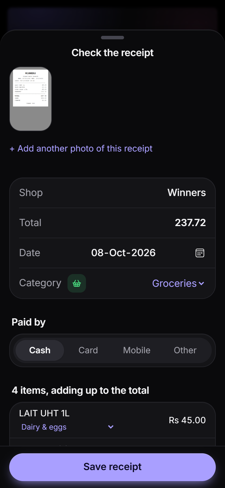

<div align="center">


# Money Manager

**Snap your receipts. See where your money goes, month by month.**

<br />

<a href="https://hemant-khadun.github.io/Money-Manager/">
  
</a>

<br />
<br />

Free&nbsp;&nbsp;·&nbsp;&nbsp;No sign-up&nbsp;&nbsp;·&nbsp;&nbsp;Works on any phone&nbsp;&nbsp;·&nbsp;&nbsp;Your receipts stay on your phone

<sub>Best on a phone. The link is <a href="https://hemant-khadun.github.io/Money-Manager/">hemant-khadun.github.io/Money-Manager</a></sub>

<br />
<br />


&nbsp;&nbsp;

&nbsp;&nbsp;


</div>

---

## What it does

Take a photo of a shop receipt. Money Manager reads it for you and keeps a tidy record of your spending.

- 📸 **Reads your receipts.** It finds the shop, the date, the total and each thing you bought. You check it, then save.
- 📊 **Shows your month at a glance.** How much you've spent so far, how that compares with last month, and where you're heading if you keep going like this.
- 🗂️ **Sorts your spending.** Groceries, fuel, eating out, pharmacy… Money Manager puts each purchase in the right category, and gets better as you correct it.
- 🎯 **Keeps you on budget.** Set a monthly budget for any category and Money Manager warns you before you go over.
- 🏷️ **Spots price rises.** See when something you buy often costs more than last time.
- ✍️ **No receipt? No problem.** Add a market or bazaar purchase by hand in a few seconds.
- 🧾 **Long receipts too.** Photograph the top, tap **Take the next part** for the rest, and Money Manager joins them into one. It tells you when a photo looks cut off.
- ✏️ **Fix or delete anything.** Correct any item before you save (lines it wasn't sure of are marked), change any saved receipt later, or delete one or several at once, with Undo if you change your mind.

## Get started in 1 minute

1. **Open the link on your phone:** [hemant-khadun.github.io/Money-Manager](https://hemant-khadun.github.io/Money-Manager/)
2. **Add it to your home screen** so it opens like a normal app:
   - **iPhone (Safari):** tap the Share button, then **Add to Home Screen**.
   - **Android (Chrome):** tap the **⋮** menu, then **Install app** or **Add to Home screen**.
3. **Tap the Scan button** in the middle, and take a photo of a receipt.
4. **Check the details** and tap **Save receipt**. That's it.

> The first scan takes a little longer while Money Manager gets ready. After that, it's quicker.

## Tips for a good photo

- Lay the receipt **flat** in **good light**, and avoid shadows.
- Get the **whole receipt** in the photo, from the shop name to the total.
- **Very long receipt?** Take several photos from top to bottom. Let each photo repeat the last two or three lines of the one before, then choose them all together.
- If the shop name is hard to read, Money Manager still recognises big supermarkets like **Intermart, Winners, Carrefour, Super U, Jumbo, Dreamprice, Spar** and more.

## Your privacy

- **Your receipts never leave your phone.** Money Manager reads the photos on the phone itself. Nothing is uploaded and there is no account.
- **Only what's needed is kept:** the shop, date, total, category, the items, and a small picture of the receipt.
- **Make a backup now and then** (Settings → *Back up now*). Your phone holds the only copy, so if you clear your browser data or change phones, the backup is how you get your receipts back.

## Questions

**Does it cost anything?**
No. It's free, with no ads and no sign-up.

**Which receipts does it read?**
Most printed receipts: supermarkets, pharmacies, fuel stations, restaurants, hardware shops and more. It's made for Mauritius: prices in rupees, receipts in English or French.

**It read something wrong. What do I do?**
Fix it on the *Check the receipt* screen before saving. Money Manager learns from your corrections for that shop.

**Scanning isn't working on my phone. What can I do?**
Open the problem report: [hemant-khadun.github.io/Money-Manager/#/debug](https://hemant-khadun.github.io/Money-Manager/#/debug) (also in Settings → *Problem report*). Try a photo there, tap **Copy report** and send it. It shows what went wrong, step by step.

**Can I use it on a computer?**
Yes, it opens in any modern browser. It's just easiest on a phone, where the camera is.

---

<details>
<summary><b>For developers</b></summary>

<br />

Money Manager is a web app that installs on the phone (a PWA). Everything runs in the browser:

- **React + TypeScript + Vite**, styled with Tailwind CSS
- **Receipt reading:** PaddleOCR (PP-OCRv5) models running in a Web Worker through ONNX Runtime Web (WebGPU, falling back to WebAssembly)
- **Understanding the receipt:** a hand-written parser that finds the shop, date, total, payment method and items, and checks that the items add up to the total
- **Storage:** IndexedDB (via Dexie), on the phone only

```bash
npm install
npm run dev        # start the app locally
npm test           # run the tests
npm run build      # build for production (also downloads the reading models)
```

Every push to `main` is tested, built and published to GitHub Pages by [.github/workflows/deploy.yml](.github/workflows/deploy.yml).
The full design notes are in [docs/PLAN.md](docs/PLAN.md).

</details>
